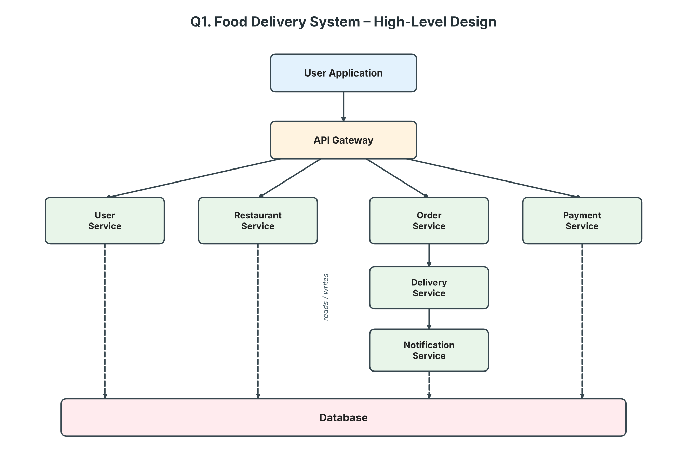
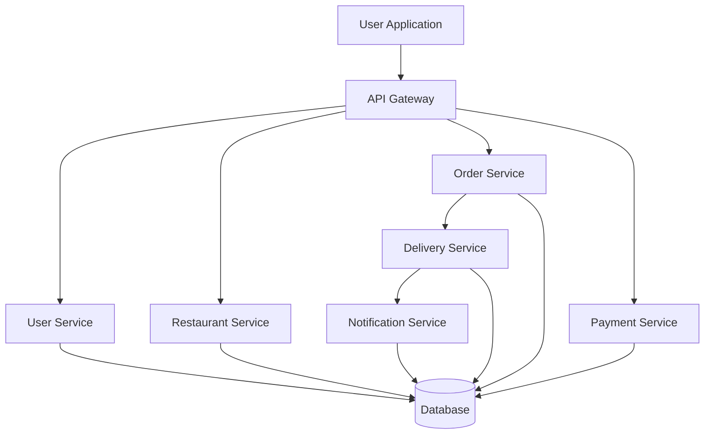
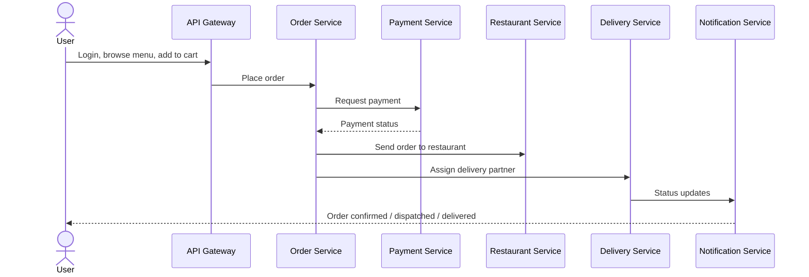
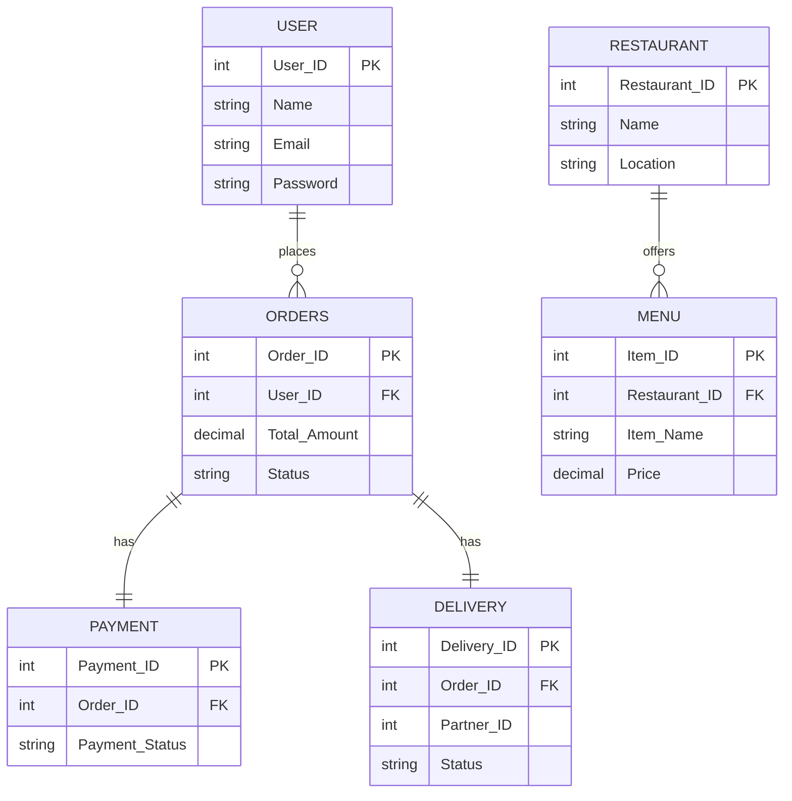

# Q1. Food Delivery System (HLD)

## 1. Introduction
A Food Delivery System is an online application that allows users to browse restaurants, view menus, order food, make online payments, and track deliveries. Examples include Swiggy and Zomato.

## 2. Features
- User registration and login
- Browse restaurants and view menus
- Add food items to cart and place orders
- Make online payments
- Track order status and delivery

## 3. High-Level Design (HLD)

The system follows a client-server architecture in which different services handle specific functionalities.

*Also available as [SVG](./hld-diagram.svg).*

Mermaid version of the HLD

## 4. Main Components
| Component | Responsibility |
|-----------|----------------|
| **User Service** | User registration, login, authentication, profile management |
| **Restaurant Service** | Restaurants, menus, food items, prices, availability |
| **Order Service** | Shopping cart, order placement, order confirmation, order status |
| **Payment Service** | Online payments via payment gateways, transaction records |
| **Delivery Service** | Assigns delivery partners and tracks delivery status |
| **Notification Service** | Order confirmation, preparation, dispatch, and delivery alerts |

## 5. Working of the System
1. The user registers or logs into the application.
2. The user browses restaurants and selects food items.
3. Selected items are added to the cart.
4. The user places an order and completes the payment.
5. The restaurant receives and prepares the order.
6. A delivery partner is assigned to collect the order.
7. The user tracks the order until it is delivered.

## 6. Database Design

## 7. Conclusion
The Food Delivery System provides a scalable and efficient platform for online food ordering. Using separate services for users, restaurants, orders, payments, and deliveries makes the system easier to maintain and expand.
