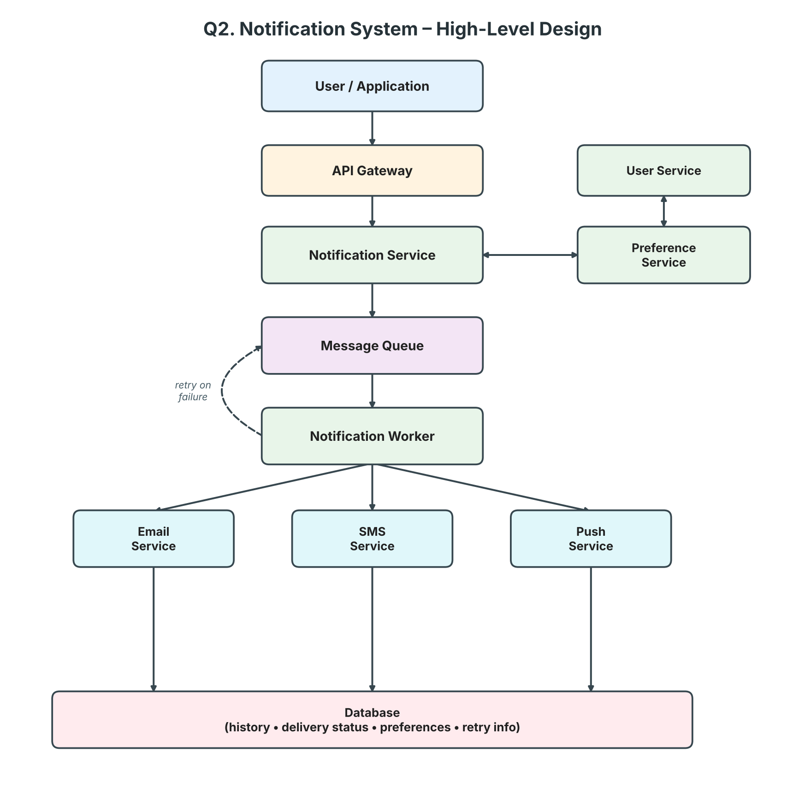
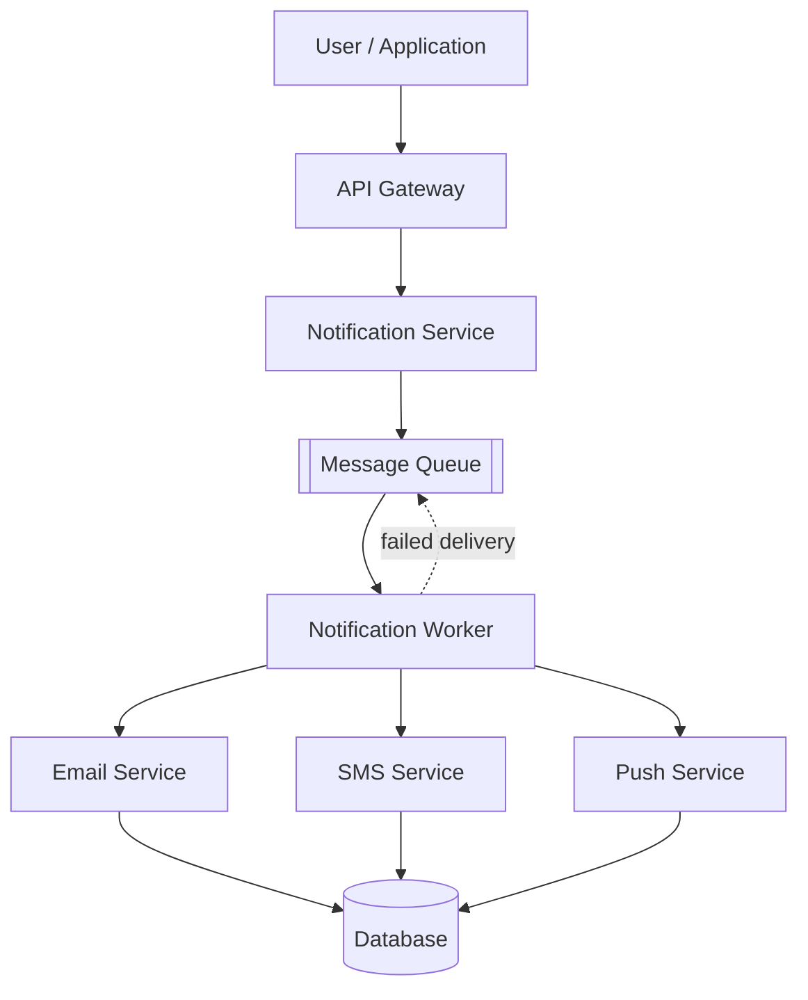
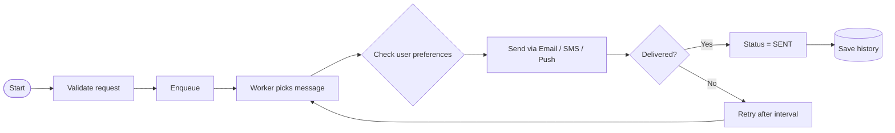
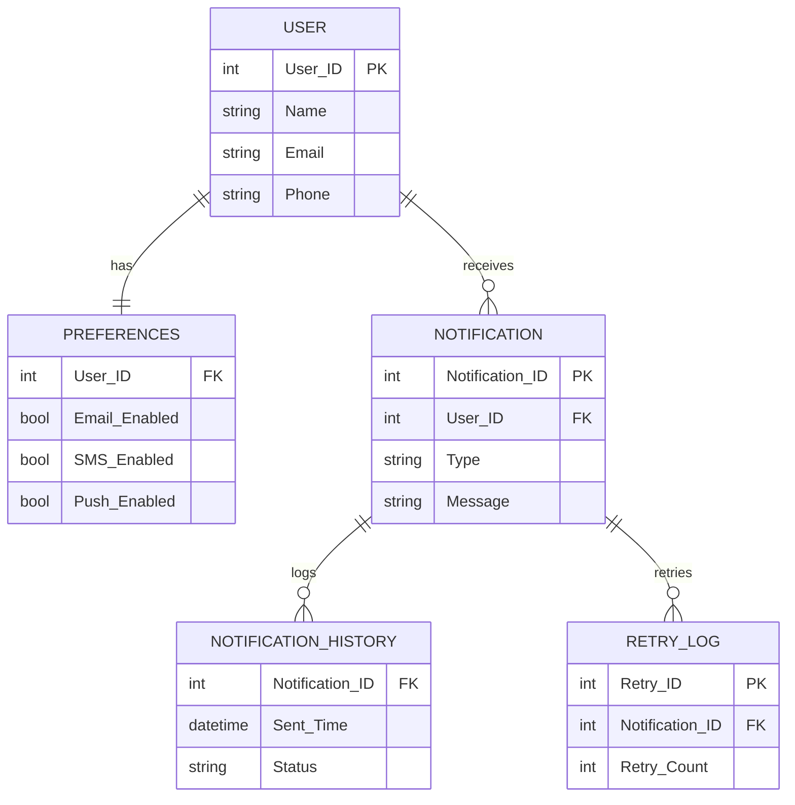

# Q2. Notification System (HLD)

## 1. Introduction
A Notification System is a software system that sends important messages and updates to users through different communication channels such as Email, SMS, and Push Notifications.

## 2. Features
- User registration and notification preferences
- Send notifications through Email, SMS, and Push
- Support different types of notifications (order updates, alerts, reminders)
- Store notification history and delivery status
- Handle failed notifications through retry mechanisms

## 3. High-Level Design (HLD)

The system uses a service-based architecture to manage notification requests, user preferences, message processing, and delivery.

*Also available as [SVG](./hld-diagram.svg).*

Mermaid version of the HLD

## 4. Main Components
| Component | Responsibility |
|-----------|----------------|
| **User Service** | Registration, contact details, authentication |
| **Preference Service** | Stores user preferences, including enabled channels |
| **Notification Service** | Accepts requests, identifies notification type and recipient |
| **Message Queue** | Temporarily stores requests and distributes them for processing |
| **Notification Workers** | Process queued messages and send via the right channel |
| **Delivery Service** | Integrates with external email, SMS, and push providers |
| **Database** | Stores history, delivery status, preferences, and retry info |

## 5. Working of the System
1. The user registers and sets notification preferences.
2. An application generates a notification request (order update, alert, reminder).
3. The Notification Service receives and validates the request.
4. The request is placed in a message queue.
5. Notification workers process the request.
6. The appropriate channel (Email, SMS, or Push) is selected.
7. The delivery status is stored in the database.
8. If delivery fails, the system retries after a specified interval.

## 6. Database Design

## 7. Conclusion
The Notification System provides reliable communication between applications and users. Message queues, background workers, and retry mechanisms improve scalability and help manage failed notifications efficiently.
