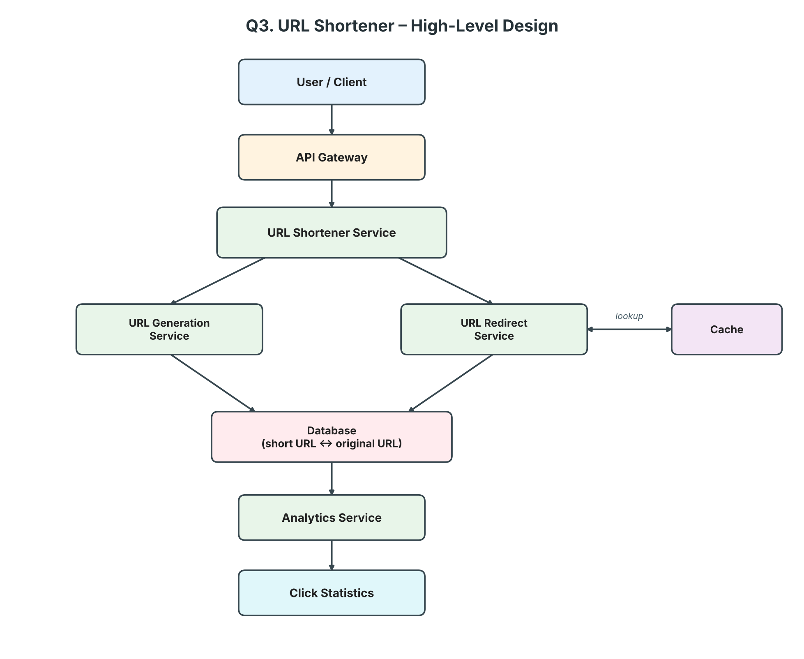
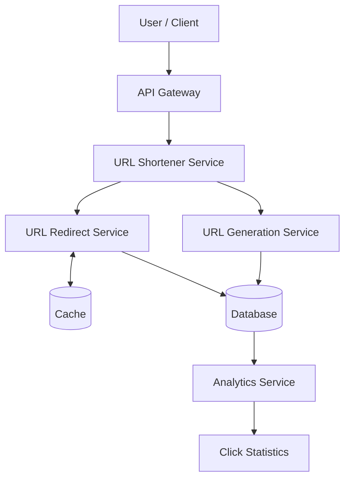
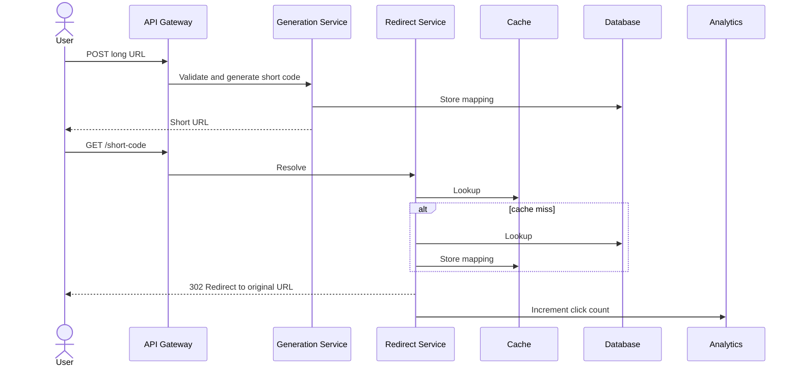
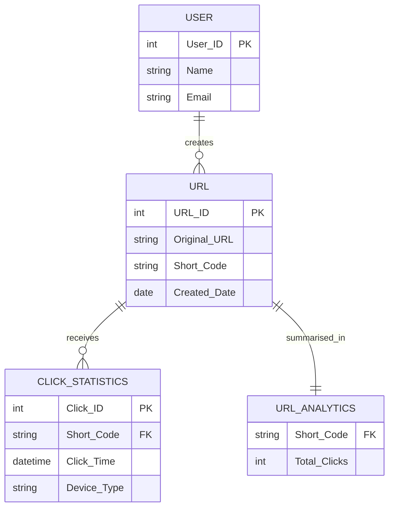

# Q3. URL Shortener (HLD)

## 1. Introduction
A URL Shortener is a web-based application that converts long URLs into short and unique links. These short links redirect users to the original URL when accessed. Examples include Bitly and TinyURL.

## 2. Features
- Accept a long URL from the user
- Generate a unique short URL
- Redirect users to the original URL
- Store the mapping between short and long URLs
- Track the number of clicks on each shortened URL

## 3. High-Level Design (HLD)

*Also available as [SVG](./hld-diagram.svg).*

Mermaid version of the HLD

## 4. Main Components
| Component | Responsibility |
|-----------|----------------|
| **API Gateway** | Receives requests and forwards them to the right services |
| **URL Generation Service** | Accepts long URLs and generates unique short codes |
| **URL Redirect Service** | Finds the original URL by short code and redirects |
| **Database** | Stores short URL to original URL mappings |
| **Analytics Service** | Tracks clicks on each shortened URL |
| **Cache** | Stores frequently accessed mappings for faster redirection |

## 5. Working of the System
1. The user enters a long URL into the application.
2. The URL Generation Service validates the URL.
3. A unique short code is generated.
4. The short code and original URL mapping are stored in the database.
5. The application generates the shortened URL and shows it to the user.
6. When someone opens the short URL, the Redirect Service looks up the original URL.
7. The user is redirected to the original website.
8. The Analytics Service updates the click count.

## 6. Database Design

## 7. Conclusion
The URL Shortener System provides an efficient way to convert long URLs into short and shareable links. Unique code generation, database mapping, caching, and click tracking help improve system performance, reliability, and scalability.
